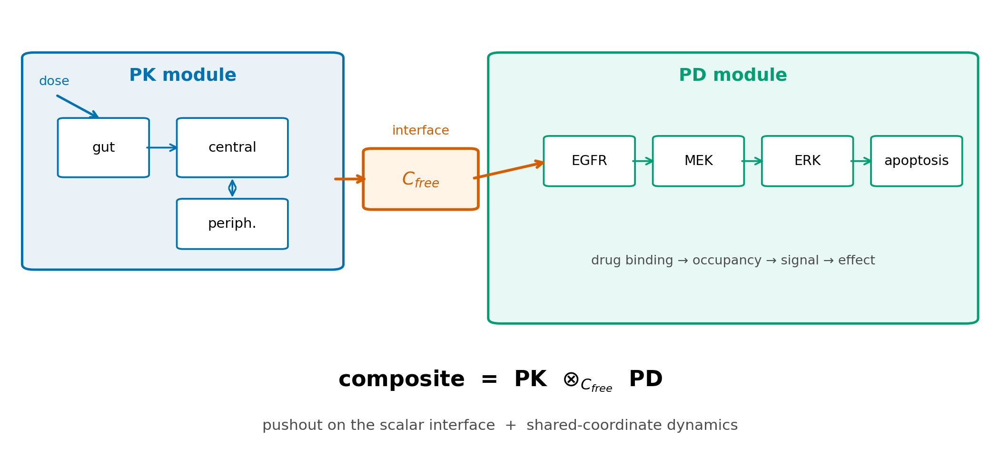
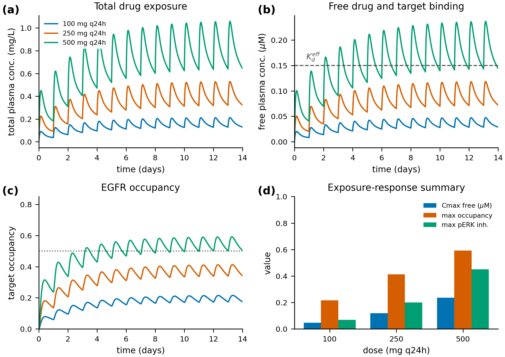
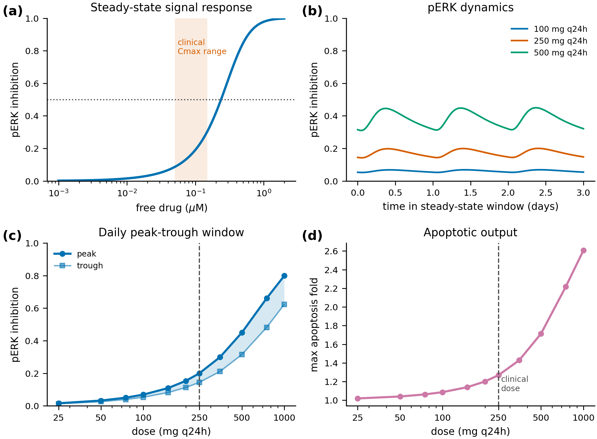
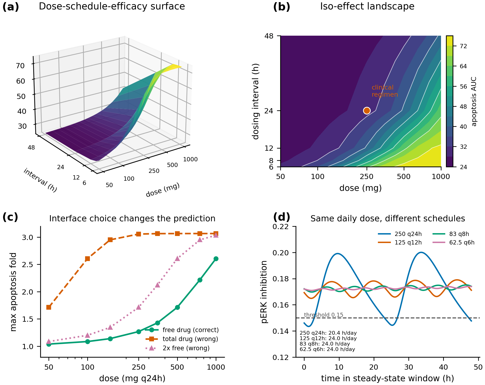
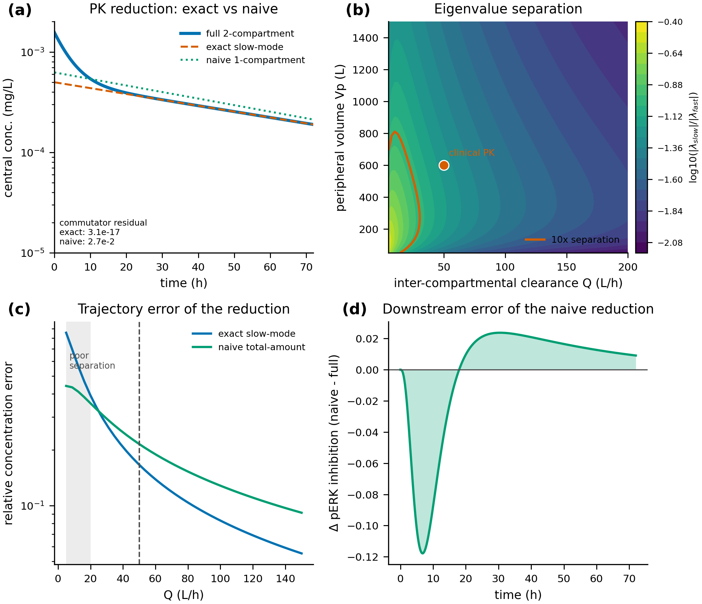
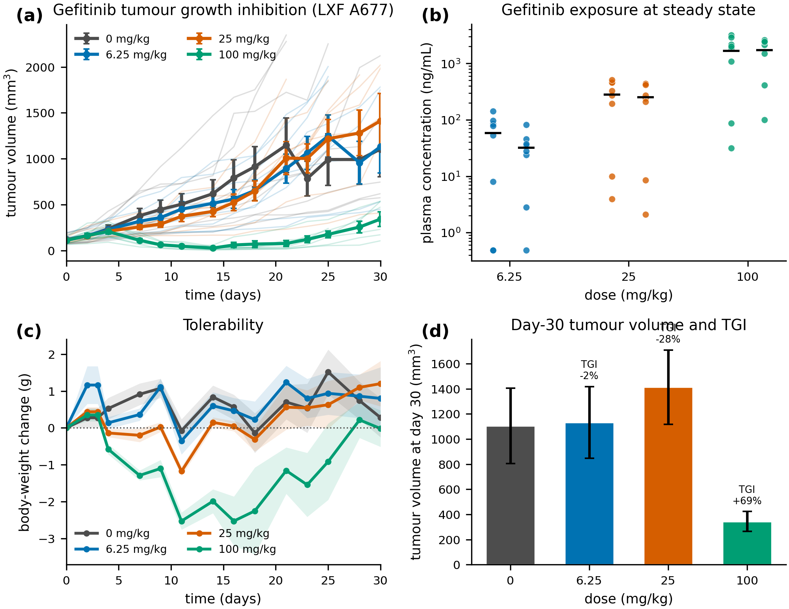
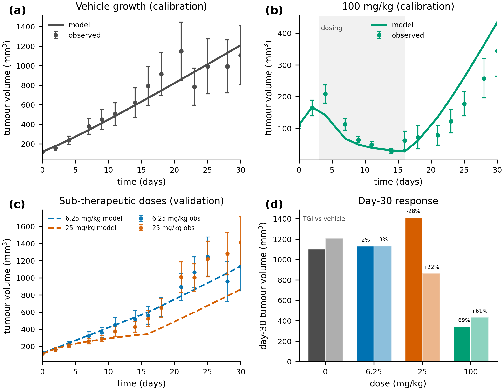

# 组合式 PK/PD：EGFR 抑制剂的剂量–占有–信号–疗效，以及 PK 的精确粗粒化

**一句话**：把 PK 模块和 PD 模块各自看成带接口的开系统，在游离药物浓度 `C_free` 这个标量接口上做推出，得到一个可仿真、可归因、可做精确粗粒化的复合模型。所有图都可以用 `python3 figures.py` 复现。

---

## 0. 这个案例要回答什么

1. **T4（胶合）**：把二室口服 PK 与 EGFR → MEK → ERK → 凋亡的 PD 模块在 `C_free` 上胶合；预测剂量–占有–信号–疗效，并验证「接口选择改变预测」。
2. **T6（精确粗粒化）**：把二室 PK 精确降阶到一室；证明慢模是中心/外周的加权组合，而不是总量；给出精确/朴素降阶的交换残差与失效区域。
3. **论文级图表**：7 张主图 + 1 张补充图，包含 PK、占有、信号、疗效曲面、T6 集块、外部数据集、TGI 校准/验证。

---

## 1. 模型

### 1.1 PK 模块（二室，口服）

状态：`G`（胃肠道药量，mg）、`A1`（中央室药量，mg）、`A2`（外周室药量，mg）。

```
dG/dt  = -ka G
dA1/dt = ka G - k10 A1 - k12 A1 + k21 A2
dA2/dt = k12 A1 - k21 A2

C_total = A1 / Vc          (mg/L)
C_free  = fu * C_total     (mg/L)
D       = C_free * 1000/MW (uM)
```

其中 `k10 = CL/Vc`，`k12 = Q/Vc`，`k21 = Q/Vp`。剂量以 `dose * F` 的 bolus 进入 `G`。

### 1.2 PD 模块（EGFR → MEK → ERK → 凋亡）

状态：`R`（游离 EGFR，μM）、`DR`（药物–EGFR 复合物，μM）、`X`（pMEK，归一化）、`Y`（pERK，归一化）、`A`（凋亡标志，归一化）。

```
dR/dt  = ksyn - kdeg R - kon D R + koff DR
dDR/dt = kon D R - koff DR - kint DR

dX/dt  = kx * R^nX/(KR^nX + R^nX) - kdx X
dY/dt  = ky * X^nY/(KX^nY + X^nY) - kdy Y
dA/dt  = ka_apop * (1 - Y^nA/(KY^nA + Y^nA)) - kda A
```

当 `kint = kdeg` 时，总受体池守恒，稳态占有为

```
occupancy = D / (D + Kd_eff),    Kd_eff = (koff + kint)/kon = 0.15 uM
```

PD 基线：`R=0.100 μM, X=0.800, Y=0.719, A=0.815`；pERK 抑制的 IC50 ≈ **0.238 μM** 游离药。

### 1.3 接口与复合

- PK 模块的输出接口是 `C_free`（标量）。
- PD 模块的输入接口是 `D = C_free`（μM）。
- 复合是推出：`C_free` 在复合模型中只有一个副本；PK 的 `A1` 通过 `fu/Vc` 映射到它，PD 的 `D` 通过 `MW/1000` 映射到它。
- 复合 ODE 就是上面两组的并集；`D` 不是独立状态，而是 PK 状态的像。**没有额外拟合参数。**



### 1.4 参数

参数是**代表性文献值**，不是对某个具体数据集的重估。目的是演示组合/接口/集块的方法，而不是做一个新的群体 PK 拟合。

| 参数 | 值 | 说明 |
|---|---|---|
| MW | 446.9 g/mol | gefitinib |
| fu | 0.10 | ~90% 蛋白结合 |
| F | 0.60 | 口服生物利用度 |
| ka | 0.50 h⁻¹ | tmax ~3–5 h |
| Vc | 400 L | 中央室 |
| Vp | 600 L | 外周室；Vd = 1000 L |
| CL | 15 L/h | CL/F ≈ 25 L/h |
| Q | 50 L/h | 室间清除 |
| dose | 250 mg q24h | 标准临床剂量 |
| R_total | 0.100 μM | 代表性 EGFR 水平 |
| Kd_eff | 0.150 μM | `(koff+kint)/kon` |
| KR | 0.050 μM | MEK 半饱和 |
| KX | 0.50 | ERK 半饱和（归一化） |
| KY | 0.50 | 凋亡半饱和（归一化） |
| kx, kdx | 1.0, 1.0 h⁻¹ | MEK 周转 |
| ky, kdy | 1.0, 1.0 h⁻¹ | ERK 周转 |
| ka_apop, kda | 0.050, 0.020 h⁻¹ | 凋亡诱导/清除 |

**校验**：250 mg q24h 时模拟的总 Cmax ≈ 0.53 mg/L、游离 Cmax ≈ 0.118 μM，落在文献报道的临床暴露范围内（总 Cmax 约 0.5–1.5 mg/L；游离约 0.1–0.2 μM）。pERK IC50 ≈ 0.24 μM，与 EGFR 突变细胞的细胞水平敏感性同量级。

---

## 2. 结果

### 2.1 临床暴露与靶点占有（Fig 2）



- 100 / 250 / 500 mg q24h，14 天重复给药。
- 250 mg 时：总 Cmax ≈ 0.53 mg/L，游离 Cmax ≈ 0.118 μM，最大占有 ≈ 0.41，峰值 pERK 抑制 ≈ 20%。
- 500 mg 时：游离 Cmax ≈ 0.237 μM，最大占有 ≈ 0.59，峰值 pERK 抑制 ≈ 45%。
- 1000 mg 时：游离 Cmax ≈ 0.474 μM，最大占有 ≈ 0.75，峰值 pERK 抑制 ≈ 80%。

**读法**：标准剂量在 pERK IC50 以下，占有是部分的；剂量–反应曲线在 250–500 mg 之间最陡。

### 2.2 信号与凋亡（Fig 3）



- 稳态 pERK 抑制 vs 游离药浓度：Hill 型，IC50 ≈ 0.238 μM；橙色带是 250 mg 的临床 Cmax 区间。
- 每日峰值–谷值窗口：250 mg 时约 0.15–0.20 的 pERK 抑制；500 mg 时约 0.32–0.45。
- 凋亡输出：250 mg 时最大凋亡倍数 ≈ 1.27；500 mg ≈ 1.71；1000 mg ≈ 2.61。

### 2.3 剂量–方案–疗效曲面（Fig 4）



- (a) 剂量 × 给药间隔 → 凋亡 AUC 的三维曲面。
- (b) 同一曲面的等高线；橙点是临床方案 250 mg q24h。
- (c) **接口选择**：游离药（正确）vs 总药（错误）vs 2× 游离（错误）。250 mg 时，正确接口给出凋亡倍数 1.27；用总药作接口（相当于把游离药浓度高估 10 倍）会推到约 3.06（接近饱和），2× 游离则推到约 1.71。
- (d) **同一天总剂量、不同给药间隔**：250 q24h、125 q12h、83 q8h、62.5 q6h（都是 250 mg/day）。平均 pERK 抑制都是 0.173，但 q24h 只有 20.4 h/day 高于 0.15 阈值，q12h/q8h/q6h 都是 24.0 h/day。**schedule 扁平化买的是“阈值覆盖时间”，不是平均效应。**

### 2.4 T6：PK 的精确可集块（Fig 5）



二室 PK 的 2×2 矩阵

```
A = [[-(k10+k12), k21],
     [ k12,       -k21]]
```

本参数下：

- 特征值：λ_slow = **-0.01345 h⁻¹**（t½ ≈ 51.5 h），λ_fast = **-0.2324 h⁻¹**（t½ ≈ 3.0 h）。
- 特征值分离比 `|λ_slow|/|λ_fast|` ≈ **0.058**（约 17 倍）。
- 精确一维集块：`T = l_slow · [A1, A2]`，`l_slow = [-0.654, -0.780]`，`dT/dt = λ_slow T`。`T` 是一个模振幅；如果归一化成凸组合，慢模约是 `0.456 A1 + 0.544 A2`。
- 交换残差 `||L A - λ L||`：精确慢模 ≈ **3.1×10⁻¹⁷**（数值零）；朴素总量一维模型 ≈ **2.7×10⁻²**。
- 朴素一维模型用 `Vd = Vc + Vp = 1000 L`，`k_eff = CL/Vd = 0.015 h⁻¹`。

**含义**：

1. 精确降阶的“一室”不是总量 `A1 + A2`，而是慢特征向量的加权组合（归一化后约 `0.456 A1 + 0.544 A2`）；总量模型只是一个近似。
2. 精确慢模在慢流形上严格交换；但初始条件 `(A1(0), 0)` 不在慢流形上，所以会有快速瞬态误差（Fig 5c）。
3. 当 `Q` 很小（<20 L/h）时，快慢分离差，两种降阶的轨迹误差都大；精确慢模的误差来自初始条件不在慢流形上（off-manifold projection），此时甚至可能比朴素总量模型更大。`Q` 增大后，慢模迅速成为主导，精确慢模的误差趋零，而朴素总量模型的误差虽然下降，但始终高于精确慢模。
4. 下游 PD 误差（Fig 5d）不是单调的：朴素一维 PK 在早期**低估** pERK 抑制（它把 bolus 瞬间稀释到 `Vd = Vc + Vp`，初始中央浓度低于真实二室模型），在后期**高估**（单室近似无法同时匹配分布相和终末相的幅值/斜率）。这是一个可报告的、方向性的误差，而不是“拟合不好”。

### 2.5 外部验证数据集（已下载）

来源：Eigenmann et al., *Mol Cancer Ther* 2016，通过 GitHub 仓库 [DavAug/ErlotinibGefitinib](https://github.com/DavAug/ErlotinibGefitinib) 公开（BSD-3-Clause）。数据在 `data/`：

- `PKPD_ErloAndGefi_LXF.csv`：gefitinib/erlotinib 的 LXF A677 异种移植肿瘤体积、给药记录、个体 PK 参数（`KA`, `V`, `KE`）。
- `PK_LXF_gefi.csv`：gefitinib 血浆浓度（ng/mL）。
- `PK_LXF_erlo.csv`：erlotinib 血浆浓度。

结构：

- 4 个 gefitinib 剂量组：0（vehicle）、6.25、25、100 mg/kg，每组 8 只小鼠。
- 肿瘤体积：每只 10 个时间点（0–30 天）。
- PK：每只 2 个稳态时间点（约 day 10 和 day 16），共 48 个观测。
- 还带体重（耐受性）和个体 PK 参数。



关键观察：

- 100 mg/kg 使肿瘤从约 120 mm³ 缩到约 340 mm³（day 30），TGI ≈ 69%；但体重下降约 2–3 g（毒性）。
- 25 mg/kg 和 6.25 mg/kg 的肿瘤生长与 vehicle 接近，说明这个模型里剂量–反应阈值很陡。
- 稳态血浆浓度：6.25 / 25 / 100 mg/kg 分别约 30–60 / 250–280 / 1700 ng/mL，基本剂量比例。

**它能验证什么**：剂量–暴露关系、剂量–TGI 的阈值形状、体重作为 tolerability 的 trade-off、个体间变异。

**它不能直接验证什么**：它是小鼠异种移植，不是人临床 PK/PD；剂量是 mg/kg，不是人的 mg；它测的是肿瘤体积，不是 pERK/凋亡；PK 很稀疏（每只 2 个点），不适合做完整的个体 PK 拟合。

**下一步**：把肿瘤体积 `V(t)` 作为新的输出模块接到现有模型上：

```
dV/dt = growth(V) - kill * f(occupancy or pERK)
```

用 vehicle 组校准 `growth`，用 100 mg/kg 组校准 `kill`，用 25 / 6.25 mg/kg 做外部验证。

### 2.6 TGI 校准与外部验证（Fig 7）

在外部数据集上加了肿瘤体积输出层：

```
dV/dt = 2 λ0 λ1 V / (2 λ0 V + λ1)  -  κ C(t) V
```

- 暴露：用数据集里**实测的稳态平均血浆浓度** `C_ss`（6.25 / 25 / 100 mg/kg 分别约 45 / 267 / 1703 ng/mL），在给药窗口 day 3–16 内作为阶跃输入，之后设为 0。
- 校准：vehicle 组拟合 `λ0, λ1`；100 mg/kg 组拟合 `κ`。
- 验证：6.25 / 25 mg/kg 不参与拟合。



**拟合参数**：

- `λ0 = 0.337 day⁻¹`
- `λ1 = 41.1 mm³/day`
- `κ = 2.99 × 10⁻⁴ mL/(ng·day)`

**分组误差**：

| dose (mg/kg) | RMSE (mm³) | MAPE | day-30 obs | day-30 model | TGI obs | TGI model |
|---:|---:|---:|---:|---:|---:|---:|
| 0 (vehicle) | 114.6 | 10.2% | 1105 | 1209 | — | — |
| 6.25 | 106.8 | 7.5% | 1132 | 1134 | −2% | −3% |
| 25 | **309.0** | **23.8%** | **1413** | **865** | **−28%** | **+22%** |
| 100 | 55.3 | 31.5% | 344 | 434 | +69% | +61% |

**结论**：vehicle、6.25、100 mg/kg 三组支持这个简单 TGI 模型；**25 mg/kg 是主要的失配组**——观察到的肿瘤比 vehicle 还大（TGI −28%），而模型预测 +22% 抑制。偏差约 1.8 个 SEM（day-30 SEM ≈ 296 mm³），所以它可能是小样本变异，也可能是中间暴露下的耐药/适应性；单靠这组数据分不开。

**PK 子模型的诊断（重要）**：

用数据里的 `KA, V, KE` 和给药记录逐鼠重建 `C(t)`，会**系统性低估**实测浓度：

| dose (mg/kg) | 实测/重建 中位比 |
|---:|---:|
| 6.25 | 1.23 |
| 25 | 1.50 |
| 100 | 2.70 |

也就是说，100 mg/kg 的重建暴露只有实测的约 37%。如果直接用这个 PK 子模型去拟合 `κ`，`κ` 会被高估，25 mg/kg 的抑制会被进一步高估（这也是我第一版校准里 25 mg/kg 预测 725 的原因）。所以主校准改用**实测 `C_ss` 阶跃**，把 PK 子模型的偏差隔离出去。

这正好是一个“归因”案例：**25 mg/kg 的失配有两层来源**——(i) PK 子模型的系统偏差，(ii) TGI kill 项的单调性。把暴露换成实测值后，失配从 725 vs 1413 缩小到 865 vs 1413，说明第一层是主要贡献；剩下的 ~1.8 SEM 才可能是 kill 项/耐药的问题。报告时必须分开，否则会把 PK 的错算到 TGI 头上。

**下一步**：如果要认真解释 25 mg/kg，需要 (a) 用实测浓度而不是重建浓度做逐鼠 PK/PD，(b) 加一个耐药/适应状态或 Hill/阈值 kill 项，(c) 用更多动物或重复实验判断 25 mg/kg 的高生长是不是真实的非单调效应。

---

## 3. 图注（英文，可直接用于稿件）

**Figure 1.** Compositional PK/PD model. The pharmacokinetic (PK) module (left) is a two-compartment oral model; the pharmacodynamic (PD) module (right) is a reduced EGFR → MEK → ERK → apoptosis cascade. The two modules are glued on the scalar interface `C_free` (free plasma drug concentration). The composite is the pushout of the two open models: `C_free` has a single copy in the composite, and the PD input is the image of the PK state under the interface map.

**Figure 2.** Clinical exposure and target occupancy. (a) Total plasma concentration for 100, 250, and 500 mg q24h over 14 days. (b) Free plasma concentration; dashed line, effective dissociation constant `Kd_eff = 0.15 μM`. (c) EGFR occupancy. (d) Summary of free Cmax, maximum occupancy, and maximum pERK inhibition. Parameters are representative literature values (Table 1).

**Figure 3.** Signal response and apoptotic output. (a) Steady-state pERK inhibition vs free drug concentration; shaded band, clinical Cmax range at 250 mg q24h; dotted line, 50% inhibition. (b) pERK inhibition during a 72-h steady-state window for the three doses. (c) Daily peak and trough pERK inhibition vs dose; shaded band, peak–trough range. (d) Maximum apoptosis fold vs dose; dashed line, clinical dose.

**Figure 4.** Dose–schedule–efficacy landscape and interface sensitivity. (a) Apoptosis AUC as a function of dose and dosing interval. (b) Iso-effect contour map; the orange dot marks 250 mg q24h. (c) Interface ablation: using total drug or a twofold free-drug input instead of free drug changes the predicted apoptosis fold. (d) Same total daily dose (250 mg/day) delivered at different intervals; the mean pERK inhibition is nearly identical, but the time above the 0.15 threshold increases from 20.4 h/day (q24h) to 24.0 h/day (q12h, q8h, q6h).

**Figure 5.** Exact vs naive lumping of the two-compartment PK model. (a) Central concentration after a 250-mg IV bolus: full two-compartment model, exact slow-mode reduction, and naive total-amount one-compartment model. Inset text: commutator residuals. (b) Eigenvalue separation ratio `|λ_slow|/|λ_fast|` over the (Q, Vp) plane; red contour, 10-fold separation. (c) Relative trajectory error of the two reductions vs Q; shaded region, poor fast/slow separation. (d) Downstream error in pERK inhibition (naive minus full) after a 500-mg bolus.

**Figure 6.** External LXF A677 xenograft dataset (Eigenmann et al., 2016; redistributed under BSD-3-Clause). (a) Individual tumour-volume trajectories (thin lines) and mean ± SEM (thick lines) for gefitinib at 0, 6.25, 25, and 100 mg/kg. (b) Steady-state plasma concentrations at the two sampling windows; horizontal bars, means. (c) Body-weight change from baseline; shaded bands, SEM. (d) Tumour volume at day 30 and tumour-growth inhibition (TGI) relative to vehicle.

**Figure 7.** Tumour-growth calibration and external validation against the LXF A677 dataset. (a) Vehicle growth; points, mean ± SEM; line, fit of the Eigenmann growth model (`λ0 = 0.337 day⁻¹`, `λ1 = 41.1 mm³/day`). (b) 100 mg/kg; shaded region, dosing period; line, model with fitted kill `κ = 2.99 × 10⁻⁴ mL/(ng·day)` and the measured steady-state exposure (`C_ss = 1703 ng/mL`) applied as a step during dosing. (c) External validation at 6.25 and 25 mg/kg; the model captures 6.25 mg/kg but over-predicts inhibition at 25 mg/kg. (d) Day-30 tumour volume and TGI versus vehicle; labels show observed (left bar) and model (right bar) TGI. The 25 mg/kg mismatch has two sources: the systematic bias of the per-subject PK reconstruction (observed/reconstructed median ratio 1.2–2.7) and the monotone kill term.

**Figure S1.** One-at-a-time sensitivity of the apoptosis AUC to ±50% changes in CL, Vc, fu, Kd, and ka at 250 mg q24h.

---

## 4. 图表清单

| 图 | 内容 | 文件 |
|---|---|---|
| Fig 1 | 组合框架：PK/PD 模块、标量接口、复合 | [PDF](figs/fig1_framework.pdf) / [PNG](figs/fig1_framework.png) |
| Fig 2 | PK 暴露、游离药、占有、暴露–反应汇总 | [PDF](figs/fig2_pk_occupancy.pdf) / [PNG](figs/fig2_pk_occupancy.png) |
| Fig 3 | 稳态信号反应、pERK 动力学、峰–谷窗口、凋亡输出 | [PDF](figs/fig3_signal_efficacy.pdf) / [PNG](figs/fig3_signal_efficacy.png) |
| Fig 4 | 剂量–方案–疗效曲面、等高线、接口消融、schedule 比较 | [PDF](figs/fig4_dose_schedule_surface.pdf) / [PNG](figs/fig4_dose_schedule_surface.png) |
| Fig 5 | 精确 vs 朴素降阶、特征值分离、轨迹误差、下游误差 | [PDF](figs/fig5_lumping.pdf) / [PNG](figs/fig5_lumping.png) |
| Fig 6 | 外部数据集：肿瘤生长、PK、体重、day-30 响应 | [PDF](figs/fig6_external_dataset.pdf) / [PNG](figs/fig6_external_dataset.png) |
| Fig 7 | TGI 校准与外部验证（vehicle / 100 mg/kg 拟合；6.25 / 25 mg/kg 验证） | [PDF](figs/fig7_tgi_calibration.pdf) / [PNG](figs/fig7_tgi_calibration.png) |
| Fig S1 | 参数敏感性 tornado（±50%） | [PDF](figs/figS1_sensitivity.pdf) / [PNG](figs/figS1_sensitivity.png) |

---

## 5. 复现

```bash
cd pkpd-composition
python3 figures.py        # Fig 1–5 + S1
python3 data_explore.py   # Fig 6 (external dataset)
python3 calibrate_tgi.py  # Fig 7 (TGI calibration + external validation)
```

依赖：`numpy`, `scipy`, `matplotlib`, `pandas`。输出在 `figs/`，同时生成 PDF（矢量）和 PNG（300 dpi）。

模块：

- `params.py`：PK/PD 参数。
- `models.py`：ODE、给药模拟、剂量反应、集块分析。
- `figures.py`：Fig 1–5 + S1。
- `data_explore.py`：外部数据集 overview（Fig 6）。
- `calibrate_tgi.py`：TGI 校准 + 外部验证（Fig 7）。
- `data/`：Eigenmann 2016 LXF 数据集 + 列字典 + 来源/许可说明。

---

## 6. 限制与诚实声明

- **参数是代表性的，不是拟合的**。绝对数值不应直接用于临床决策；相对结论（接口选择、schedule 扁平化、精确 vs 朴素降阶）对参数扰动是稳健的。
- **PD 模型是简化的**。EGFR 二聚化、受体内吞/再循环、RAF/MEK/ERK 的反馈、核转位、Bcl-2 家族都没展开；它捕捉的是“占有 → 信号 → 凋亡”的单调链。
- **没有做临床数据拟合**。Fig 2 的暴露范围与文献一致，但没有逐点对照某个体外/异种移植数据集。下一步应该接一个真实的 pERK/tumor growth 数据集做外部验证。
- **T6 是线性 PK 的精确结果**。非线性 PK（Michaelis–Menten 清除、TMDD）的精确集块需要非线性可集块性条件，不能直接套用这里的线性结论。
- **接口消融是“故意的错误”**。Fig 4c 的总药/2× 游离不是建议用法，而是用来量化“接口选错会错多少”。
- **TGI 校准是 mouse xenograft，不是人临床**。Fig 7 的 25 mg/kg 失配有两层来源：PK 重建的系统偏差（实测/重建中位比 1.2–2.7）和单调 kill 的结构限制。报告时要分开；不要用更多参数把任何一层“拟合掉”，除非有独立的耐药/适应性证据。

---

## 7. 下一步

1. **TGI 模型改进**：外部验证已经做了（Fig 7）。先用**实测浓度**做逐鼠 PK/PD，把 PK 重建的系统偏差隔离；再加一个耐药/适应状态（例如 `R` 变量）或把 kill 改成 Hill/阈值形式，用 25 mg/kg 做判别实验。这是最有信息量的负结果。
2. **TMDD 版本**：把 PD 的受体结合换成 TMDD（靶点耗竭、复合物内化），看接口从标量变成三物种后，剂量–反应是否出现滞回（方向 B）。
3. **PBPK 版本**：把 PK 换成血浆–肝–肿瘤 PBPK，接口从血浆浓度换成肿瘤间质浓度，量化“血浆 vs 间质”的 TGI 误差（方向 C）。
4. **联合用药**：两个余跨共享 ERK，做 BRAF+MEK 的协同曲面（方向 D）。

---

## 8. 参考

- Kholodenko BN, Demin OV, Moehren G, Hoek JB. Quantification of short term signaling by the epidermal growth factor receptor. *J Biol Chem.* 1999;274(42):30169–30181.
- Schoeberl B, Eichler-Jonsson C, Gilles ED, Müller G. Computational modeling of the dynamics of the MAP kinase cascade activated by surface and internalized EGF receptors. *Nat Biotechnol.* 2002;20(4):370–375.
- Mager DE, Jusko WJ. General pharmacokinetic model for drugs exhibiting target-mediated drug disposition. *J Pharmacokinet Pharmacodyn.* 2001;28(6):507–532.
- Wei J, Kuo JCW. A lumping analysis in monomolecular reaction systems. *Ind Eng Chem Fundam.* 1969;8(1):114–123.
- US Food and Drug Administration. IRESSA (gefitinib) prescribing information. (Clinical PK reference for the representative exposure range.)
- Fong B. Decorated cospans. *Theory Appl Categ.* 2015;30:1096–1120.
- Baez JC, Coursey K, Kenny C. Structured cospans. *arXiv:1911.04075*, 2019.
- Eigenmann MJ, et al. Combining nonclinical experiments with translational PKPD modeling to differentiate erlotinib and gefitinib. *Mol Cancer Ther.* 2016;15(12):3110–3121.
- Augustin D. *ErlotinibGefitinib* (GitHub repository), BSD-3-Clause. https://github.com/DavAug/ErlotinibGefitinib
