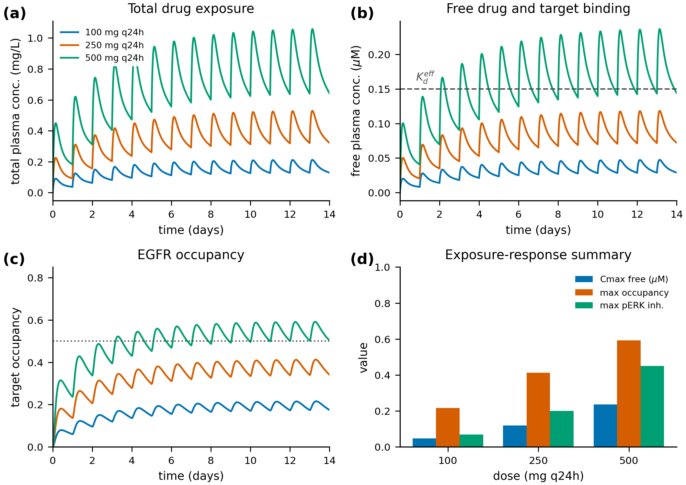

# Compositional PK/PD

**A model is reusable only when its interface is explicit.** This repository turns a pharmacokinetic (PK) model and a pharmacodynamic (PD) model into *open systems*, glues them on the free-drug concentration, and shows what composition buys: dose–schedule optimization, interface-error attribution, exact lumping, and external tumour-growth validation.


---

## The problem

BioModels hosts thousands of SBML models, yet few are reused. The bottleneck is not the file format. SBML describes **closed** systems: there is no native notion of a port, a boundary, or a typed interface. When two models share a species, "sharing" is a string match. There is no pushout, no associativity, and no guarantee that the composite means what you think it means.

Category theory supplies the missing structure:

- an **open model** is a cospan `I -> S <- O` with a decoration (the reaction network);
- **gluing** is the pushout on the shared interface;
- **semantics** is a functor from open models to dynamical systems.

The practical consequence is simple: **shared coordinates get the sum of both vector fields; everything else is untouched.** The interface is exactly where the semantics changes. That is what makes "which interface did you choose?" a falsifiable question.

---

## What is in this repository

| Task | Status | What it shows |
|---|---|---|
| **T4** — glue two models | done | two-compartment gefitinib PK ⊗ EGFR → MEK → ERK → apoptosis PD on `C_free`; dose–occupancy–signal–efficacy |
| **T6** — exact lumping | done | exact slow mode of the 2-compartment PK vs the naive total-amount 1-compartment model |
| **External validation** | done | LXF A677 xenograft TGI: vehicle / 6.25 / 100 mg/kg fit; 25 mg/kg anomaly |
| **T5** — composability index | blueprint | interface signature + profunctor/coend index; not run at 100-model scale |

---

## What the model shows

### 1. The standard dose is sub-IC50

At 250 mg q24h, the simulated free Cmax is **0.118 μM**, the maximum EGFR occupancy is **0.41**, and the peak pERK inhibition is **20%**. The pERK IC50 is **0.238 μM**, so the clinical dose sits on the steep part of the curve but below the half-maximal point. Doubling the dose to 500 mg gives 0.237 μM, 0.59 occupancy, and 45% inhibition.



### 2. Schedule flattening buys coverage, not average effect

At the same total daily dose (250 mg/day), four schedules give almost identical mean pERK inhibition (**0.173**), but very different time above the 0.15 threshold:

| schedule | time above 0.15 |
|---|---:|
| 250 mg q24h | **20.4 h/day** |
| 125 mg q12h | **24.0 h/day** |
| 83 mg q8h | **24.0 h/day** |
| 62.5 mg q6h | **24.0 h/day** |

The q24h regimen has a higher peak (0.20) but dips below 0.15; the flatter regimens stay above it all day. **If the target is threshold coverage rather than average exposure, schedule matters more than dose.**


### 3. Interface choice changes the prediction

Using **total** drug instead of **free** drug as the PD interface pushes the 250 mg apoptosis output from **1.27** to **3.06** (near saturation); using 2× free drug gives **1.71**. The difference is not a fitting artefact: it is exactly the interface map `D = fu · C_total`. This is the T4 criterion in action.

### 4. The exact PK reduction is not the total amount

The two-compartment PK has eigenvalues **−0.01345** and **−0.2324 day⁻¹** (half-lives 51.5 h and 3.0 h; separation ≈ 17×). The exact one-dimensional lumping is a weighted mode,

```
T = 0.456 A1 + 0.544 A2,    dT/dt = −0.01345 T,
```

not the total amount `A1 + A2`. The commutator residual is **3.1 × 10⁻¹⁷** for the exact slow mode and **2.7 × 10⁻²** for the naive total-amount model. The naive model under-predicts pERK inhibition early and over-predicts it late — a directional error, not noise.


### 5. External TGI: the model fits the edges, not the middle

We calibrated a tumour-growth output layer on the public LXF A677 xenograft dataset:

```
dV/dt = 2 λ0 λ1 V / (2 λ0 V + λ1) − κ C(t) V
```

| parameter | value |
|---|---|
| λ0 | 0.337 day⁻¹ |
| λ1 | 41.1 mm³/day |
| κ | 2.99 × 10⁻⁴ mL/(ng·day) |

The model fits vehicle (RMSE 115), 6.25 mg/kg (107), and 100 mg/kg (55). **25 mg/kg is the mismatch**: the observed tumours grow more than vehicle (TGI −28%), while the model predicts +22%. The deviation is ≈1.8 SEM.

Half of that mismatch is not the TGI model: reconstructing each mouse's PK from the tabulated `KA, V, KE` underestimates the measured concentrations by a median factor of **1.23 (6.25), 1.50 (25), 2.70 (100)**. Using it directly inflates κ and makes the 25 mg/kg prediction worse (725 vs 865). The primary calibration therefore uses the **measured** steady-state exposure, which isolates the PK bias from the kill term.


---

## Reproduce

```bash
git clone https://github.com/Photon817/compositional-pkpd.git
cd compositional-pkpd
pip install -r requirements.txt

python3 figures.py        # Fig 1–5 + S1
python3 data_explore.py   # Fig 6 (external dataset)
python3 calibrate_tgi.py  # Fig 7 (TGI calibration + validation)
```

---

## Repository layout

```
.
├── README.md                 # this file
├── METHODS.md                # detailed derivations, parameter table, captions
├── params.py                 # PK/PD parameters
├── models.py                 # ODEs, dosing, dose–response, lumping
├── figures.py                # Fig 1–5 + S1
├── data_explore.py           # Fig 6
├── calibrate_tgi.py          # Fig 7
├── data/
│   ├── README.md             # source, license, column dictionary
│   └── *.csv                 # LXF A677 dataset (BSD-3-Clause)
└── figs/
    ├── fig1_framework.*      # framework
    ├── fig2_pk_occupancy.*
    ├── fig3_signal_efficacy.*
    ├── fig4_dose_schedule_surface.*
    ├── fig5_lumping.*
    ├── fig6_external_dataset.*
    ├── fig7_tgi_calibration.*
    └── figS1_sensitivity.*
```

---

## Data and attribution

The external dataset is from **Eigenmann et al., *Mol Cancer Ther* 2016**, redistributed via the BSD-3-Clause repository [`DavAug/ErlotinibGefitinib`](https://github.com/DavAug/ErlotinibGefitinib). The CSVs are unmodified; see [`data/README.md`](data/README.md) for the column dictionary and the original citation.

The code in this repository is released under the **BSD 3-Clause License** (see [`LICENSE`](LICENSE)).

---

## Caveats

- **The human PK/PD parameters are representative, not a fit.** They are assembled from clinical PK and generic EGFR/MAPK biology; the absolute numbers are not for clinical decision-making.
- **The PD model is reduced.** No dimerisation, receptor recycling, RAF/MEK/ERK feedback, nuclear translocation, or Bcl-2 family; it captures the monotone chain occupancy → signal → apoptosis.
- **The TGI calibration is mouse xenograft, not human.** The 25 mg/kg mismatch has two sources — PK reconstruction bias and the monotone kill term — and the two must be reported separately.
- **T5 is a design, not a 100-model experiment.** The interface signature and profunctor/coend index are specified in [`METHODS.md`](METHODS.md); the full retrieval benchmark remains future work.
