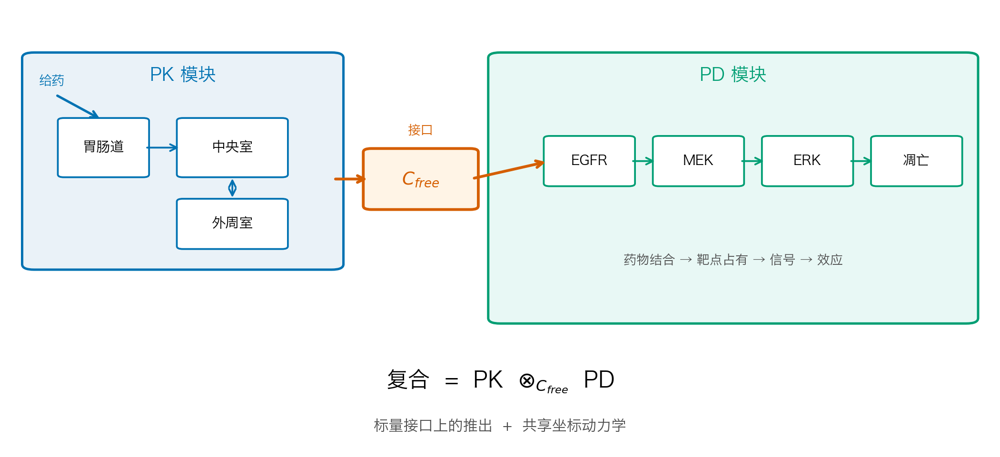
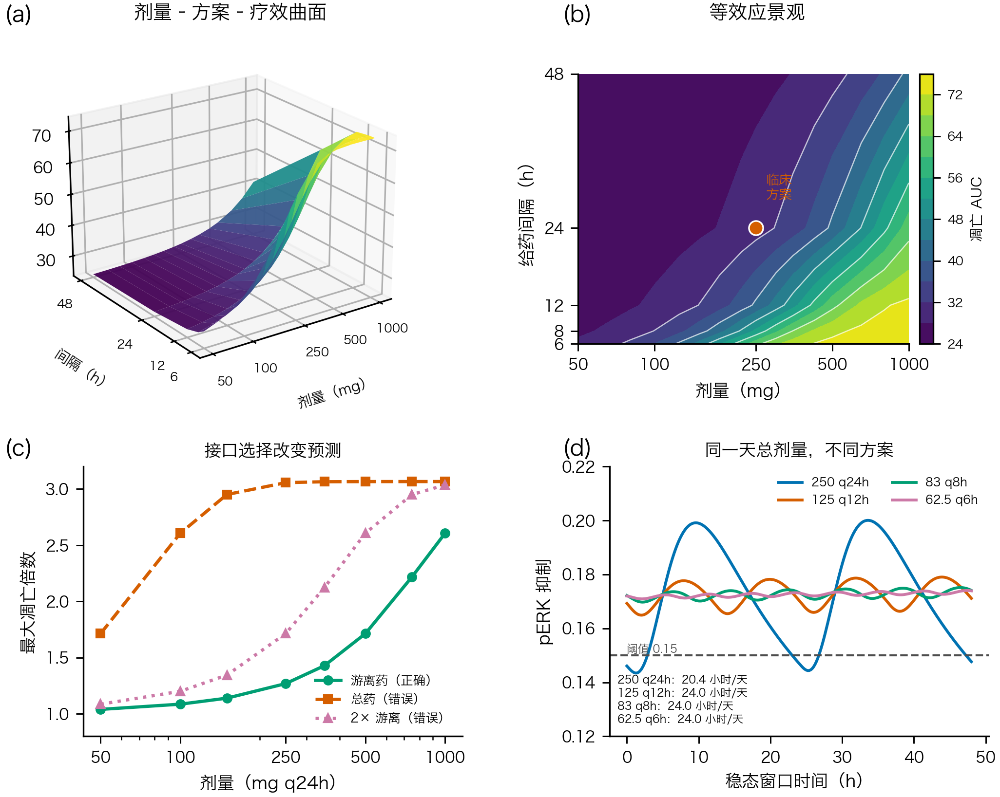
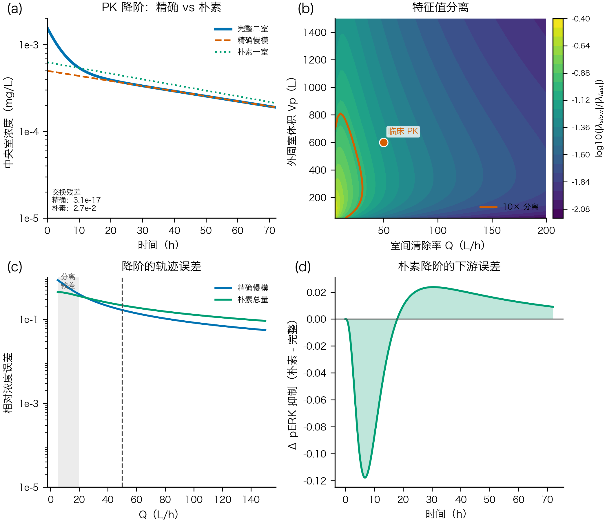
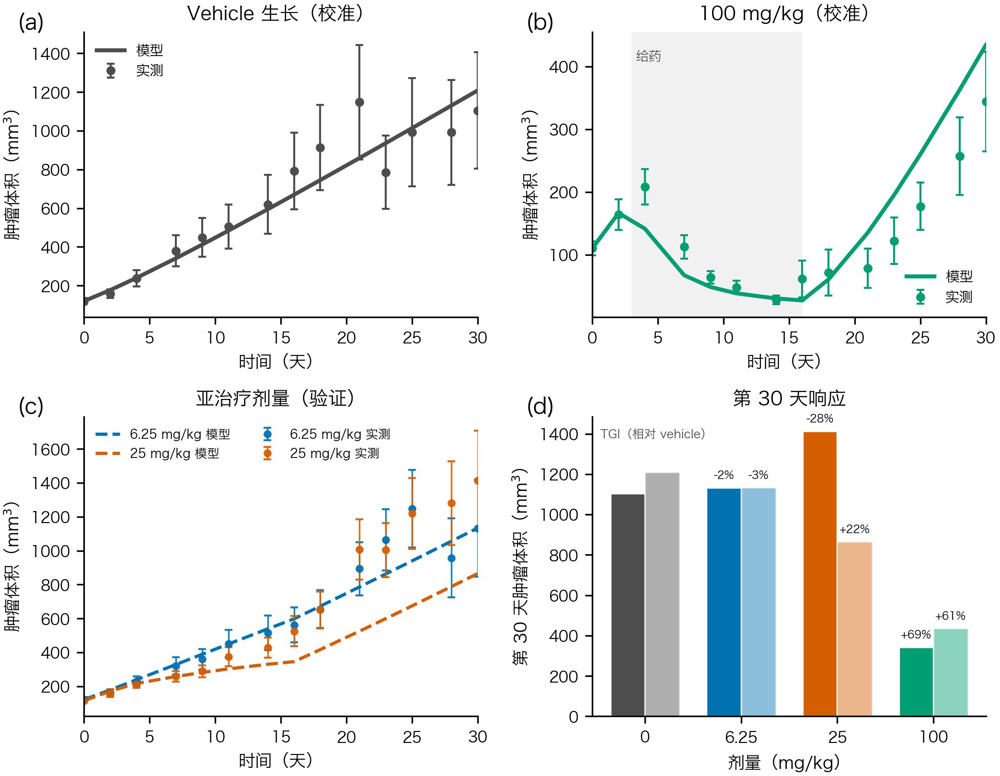

# 组合式 PK/PD

**模型只有把接口说清楚，才可能被复用。** 这个仓库把一个 PK 模型和一个 PD 模型变成「开系统」，在游离药物浓度上做推出，展示组合到底买到了什么：剂量–方案优化、接口误差归因、精确粗粒化，以及外部肿瘤生长验证。



---

## 问题

BioModels 有上千个 SBML 模型，真正被复用的很少。瓶颈不是文件格式。SBML 描述的是**闭系统**：没有原生的端口、边界、类型化接口。两个模型共享一个物种时，「共享」只是字符串匹配；没有推出、没有结合律，也没有任何东西保证复合模型的意思和你以为的一样。

范畴论补的正是这块：

- **开模型** = 带装饰的余跨 `I -> S <- O`；
- **胶合** = 共享接口上的推出；
- **语义** = 从开模型到动力系统的函子。

实际后果很简单：**共享坐标得到两边向量场之和，其余坐标不动。** 接口就是语义被修改的地方。也正因如此，「你选的是哪个接口？」才成为一个可以被证伪的问题。

---

## 仓库里有什么

| 任务 | 状态 | 内容 |
|---|---|---|
| **T4** — 胶合两个模型 | 完成 | 二室 gefitinib PK ⊗ EGFR → MEK → ERK → 凋亡 PD，接口为 `C_free`；剂量–占有–信号–疗效 |
| **T6** — 精确集块 | 完成 | 二室 PK 的精确慢模 vs 朴素总量一室模型 |
| **外部验证** | 完成 | LXF A677 异种移植 TGI：vehicle / 6.25 / 100 mg/kg 拟合；25 mg/kg 异常 |
| **T5** — 可组合性索引 | 设计 | 接口签名 + profunctor/coend 索引；未做 100 模型规模的实验 |

---

## 模型说明了什么

### 1. 标准剂量在 IC50 以下

250 mg q24h 时，模拟的游离 Cmax 为 **0.118 μM**，最大 EGFR 占有为 **0.41**，峰值 pERK 抑制为 **20%**。pERK 的 IC50 是 **0.238 μM**，所以临床剂量落在曲线陡峭段，但在半最大点以下。把剂量加倍到 500 mg，得到 0.237 μM、0.59 占有、45% 抑制。


### 2. schedule 扁平化买的是覆盖时间，不是平均效应

在相同日总剂量（250 mg/day）下，四种方案的**平均 pERK 抑制几乎相同（0.173）**，但高于 0.15 阈值的时间差别很大：

| 方案 | 高于 0.15 的时间 |
|---|---:|
| 250 mg q24h | **20.4 小时/天** |
| 125 mg q12h | **24.0 小时/天** |
| 83 mg q8h | **24.0 小时/天** |
| 62.5 mg q6h | **24.0 小时/天** |

q24h 的峰值更高（0.20），但会掉到 0.15 以下；更扁平的方案全天都在阈值以上。**如果目标是阈值覆盖而不是平均暴露，schedule 比剂量更重要。**



### 3. 接口选择会改变预测

用**总药**而不是**游离药**作为 PD 接口，会把 250 mg 的凋亡输出从 **1.27** 推到 **3.06**（接近饱和）；用 2× 游离药则推到 **1.71**。这不是拟合假象，而是接口映射 `D = fu · C_total` 的直接后果。这就是 T4 判据在起作用。

### 4. 精确 PK 降阶不是总量

二室 PK 的特征值是 **−0.01345** 和 **−0.2324 day⁻¹**（半衰期 51.5 h 和 3.0 h；分离约 17×）。精确的一维集块是一个加权模：

```
T = 0.456 A1 + 0.544 A2,    dT/dt = −0.01345 T,
```

不是总量 `A1 + A2`。交换残差对精确慢模是 **3.1 × 10⁻¹⁷**，对朴素总量模型是 **2.7 × 10⁻²**。朴素模型在早期低估 pERK 抑制、后期高估——这是方向性误差，不是噪声。



### 5. 外部 TGI：模型拟合了两端，没拟合中间

在公开的 LXF A677 异种移植数据上校准了一个肿瘤体积输出层：

```
dV/dt = 2 λ0 λ1 V / (2 λ0 V + λ1) − κ C(t) V
```

| 参数 | 值 |
|---|---|
| λ0 | 0.337 day⁻¹ |
| λ1 | 41.1 mm³/day |
| κ | 2.99 × 10⁻⁴ mL/(ng·day) |

模型拟合 vehicle（RMSE 115）、6.25 mg/kg（107）和 100 mg/kg（55）。**25 mg/kg 是失配组**：观察到的肿瘤比 vehicle 还大（TGI −28%），模型却预测 +22%；偏差约 1.8 SEM。

其中一半不是 TGI 模型的错：用数据里的 `KA, V, KE` 逐鼠重建 PK，会低估实测浓度，中位比为 **1.23（6.25）、1.50（25）、2.70（100）**。直接拿它拟合会把 κ 高估，25 mg/kg 的预测更差（725 vs 865）。所以主校准用**实测稳态暴露**，把 PK 偏差和 kill 项分开。



---

## 复现

```bash
git clone https://github.com/Photon817/compositional-pkpd.git
cd compositional-pkpd
pip install -r requirements.txt

python3 figures.py        # 图 1–5 + S1
python3 data_explore.py   # 图 6（外部数据）
python3 calibrate_tgi.py  # 图 7（TGI 校准 + 验证）
```

---

## 目录

```
.
├── README.md                 # 本文件
├── METHODS.md                # 详细推导、参数表、图注
├── params.py                 # PK/PD 参数
├── models.py                 # ODE、给药、剂量反应、集块
├── figures.py                # 图 1–5 + S1
├── data_explore.py           # 图 6
├── calibrate_tgi.py          # 图 7
├── data/
│   ├── README.md             # 来源、许可、列字典
│   └── *.csv                 # LXF A677 数据集（BSD-3-Clause）
└── figs/
    ├── fig1_framework.*      # 组合框架
    ├── fig2_pk_occupancy.*
    ├── fig3_signal_efficacy.*
    ├── fig4_dose_schedule_surface.*
    ├── fig5_lumping.*
    ├── fig6_external_dataset.*
    ├── fig7_tgi_calibration.*
    └── figS1_sensitivity.*
```

---

## 数据与署名

外部数据来自 **Eigenmann et al., *Mol Cancer Ther* 2016**，通过 BSD-3-Clause 仓库 [`DavAug/ErlotinibGefitinib`](https://github.com/DavAug/ErlotinibGefitinib) 转发。CSV 未修改；列字典和原始引用见 [`data/README.md`](data/README.md)。

本仓库代码使用 **BSD 3-Clause License**（见 [`LICENSE`](LICENSE)）。

---

## 局限

- **人 PK/PD 参数是代表性的，不是拟合结果。** 它们来自临床 PK 和通用 EGFR/MAPK 生物学；绝对数值不能用于临床决策。
- **PD 模型是简化的。** 没有二聚化、受体内吞/再循环、RAF/MEK/ERK 反馈、核转位、Bcl-2 家族；它捕捉的是「占有 → 信号 → 凋亡」的单调链。
- **TGI 校准是小鼠异种移植，不是人。** 25 mg/kg 的失配有两层来源——PK 重建偏差和单调 kill 项——报告时必须分开。
- **T5 是设计，不是 100 模型实验。** 接口签名和 profunctor/coend 索引写在 [`METHODS.md`](METHODS.md)；完整检索基准是后续工作。
